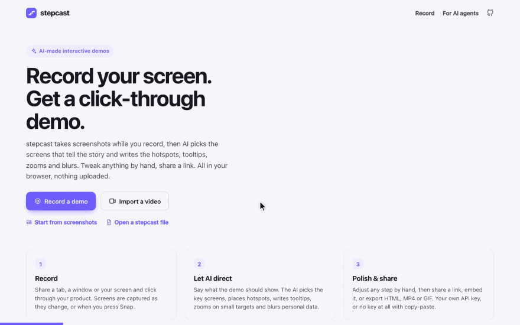

# stepcast

Record your screen, and AI turns it into an interactive, click-through product demo, in the
spirit of Storylane or Arcade. stepcast takes screenshots while you record. A vision model then
picks the screens that tell the story and writes each step: the hotspot to click, the tooltip,
a zoom on small targets, blurs over personal data, and replacements for text on screen. Adjust
anything by hand, then share a link. It is frontend only: no account, no server, nothing
uploaded.

**→ [maxgfr.github.io/stepcast](https://maxgfr.github.io/stepcast/)** ·
**[▶ the 1-minute video](https://maxgfr.github.io/stepcast/media/stepcast-demo.mp4)** (a real session:
recording a to-do app, AI mode with Claude, review, share)



## How it works

1. **Record.** Share a tab, a window or your screen and click through your product. Five times a
   second, a small copy of the screen goes to a keyframe detector, which keeps every screen worth
   having: the screen just **before** each change (the cursor resting on what is about to be
   clicked), the screen **after** it settles, and one per second while it keeps moving (scrolling,
   typing). Each new screenshot is compared with all the ones already taken, so going back to a
   screen never stores it twice. **Snap step** saves the current screen right away, and the
   floating controls (Document Picture-in-Picture) stay on top of your other windows. You can also
   import a video (same detector) or a set of screenshots.
2. **Let AI direct** (AI mode). Say in one sentence what the demo should show, plus the audience,
   tone, language (16, from your browser's by default), number of steps and any text to replace ("Globex Corp" → "Acme"). Three passes:
   when there are many frames, numbered contact sheets go out in one request and the model picks
   the key screens; the chosen screens then go out together and the model writes the whole demo
   as structured JSON, describing each target ("the 'Active' filter link under the list"); last,
   one small request per step, in parallel, on the clean screenshot, places every box: hotspot,
   highlights, blurs over personal data, and each occurrence of the text to replace. Asked about
   a few named things on one image, models place boxes exactly; the zoom is then rebuilt around
   the panel that holds the target. Each step has a **Refine with AI** box ("point at the Export
   button", "shorter"). Tooltips go on the side of the hotspot where they stay inside the frame
   and cover no highlight.
3. **Or do it by hand** (manual mode). Pick screenshots from the strip or scrub the recording, and
   draw hotspots, zooms, highlights, blurs and text replacements on the stage.
4. **Share.** Before anything leaves the app, redactions and text edits are painted into the
   pixels, so a shared demo never holds what you hid.

|            |                                                                                                                                                                                                                                                                                                                                                                                                                                                        |
| ---------- | ------------------------------------------------------------------------------------------------------------------------------------------------------------------------------------------------------------------------------------------------------------------------------------------------------------------------------------------------------------------------------------------------------------------------------------------------------ |
| AI models  | Bring your own key through [llm-connect](https://github.com/maxgfr/llm-models/tree/main/packages/llm-connect): Anthropic, OpenAI, Google, Mistral and every OpenAI-compatible provider of the [llm-models](https://github.com/maxgfr/llm-models) catalog, or a local server (Ollama, LM Studio). Calls go straight from the browser to the provider. The key is encrypted at rest under a non-extractable WebCrypto key. Text-only models are flagged. |
| No key?    | **Copy-paste mode** copies the same prompt, plus one picture of your screenshots, for any chat app (ChatGPT, Claude, Gemini). Paste its JSON answer back.                                                                                                                                                                                                                                                                                              |
| Languages  | The demo is written in the language you pick (the 16 of llm-connect's `RESPONSE_LANGUAGES`: English, Français, Español, Deutsch, 日本語, العربية…), and the player's buttons, cards and labels follow it, right to left for Arabic. **Translate** in the Demo tab rewrites every text into another language with one text-only request; button names quoted from the screenshots stay as they appear on screen.                                        |
| Player     | Pulsing hotspots, tooltips that stay inside the frame (a bottom sheet on phones), animated zoom, spotlight highlights, intro and end cards with a call to action, keyboard navigation, and a frame around the screenshots (a gradient, a window bar, a shadow) that the videos draw too.                                                                                                                                                               |
| Share link | The whole demo is packed into the link: deflate-compressed, base64url, with images re-encoded until it fits. No server is involved.                                                                                                                                                                                                                                                                                                                    |
| Gist link  | For big demos: a secret Gist on your GitHub account (your token, `gist` scope), and a short `#/gist/<id>` link.                                                                                                                                                                                                                                                                                                                                        |
| Embed      | An `<iframe>` snippet for any share or Gist link.                                                                                                                                                                                                                                                                                                                                                                                                      |
| Export     | One self-contained **HTML** file that plays offline; **MP4** (WebCodecs through [Mediabunny](https://mediabunny.dev)) and **GIF** (delta frames over a shared palette) with a camera that glides and a cursor that clicks; the editable **project JSON**.                                                                                                                                                                                              |
| Storage    | Projects, screenshots and recordings live in IndexedDB, in your browser only. Undo and redo for every edit.                                                                                                                                                                                                                                                                                                                                            |

Shortcuts in the editor: `V` select, `H` hotspot, `Z` zoom, `L` highlight, `B` blur, `T` replace
text, `Delete` removes the selected box, `Esc` deselects, `⌘Z` / `⇧⌘Z` undo and redo, `↑` `↓`
change step. In the player: `→`, `Space` or `Enter` for the next step, `←` to go back.

## For AI agents

The demo format is plain JSON with a published [JSON Schema](https://maxgfr.github.io/stepcast/schema.json),
described in [llms.txt](https://maxgfr.github.io/stepcast/llms.txt). An agent can write a demo
(screenshots as `data:` URLs, boxes normalized to 0–1), and the user opens it with **Open a
stepcast file** to review, polish and share it.

## Privacy

- The page's Content-Security-Policy allows no inline script, no eval and no third-party script.
  It can connect only to `https:` APIs (your AI provider, the model catalog, GitHub when you
  publish a Gist) and to local model servers.
- Recordings and screenshots never leave the device, except the screenshots you send to the AI
  provider you chose, and what you choose to share.
- Blurs and text replacements are baked into the images of every share link, Gist and export.

## Develop

```bash
bun install
bun run dev        # http://localhost:5173/stepcast/, rebuilt on change
bun run test       # unit tests
bun run test:e2e   # Playwright: record with a fake screen, AI mode against a mocked model, share, export
bun run lint && bun run typecheck
bun run build      # dist/, deployed to GitHub Pages by .github/workflows/pages.yml
bun run catalog    # refresh public/models.json, the offline fallback of the model catalog
bun scripts/make-sample.ts --gif   # rebuild the home page demo and docs/demo.gif (after a build)
STEPCAST_KEY=sk-ant-… bun scripts/make-video.ts   # re-film public/media/stepcast-demo.mp4 (real model, needs ffmpeg)
```

Stack: Bun, TypeScript, Preact with signals, Zod, the AI SDK through llm-connect, Mediabunny and
gifenc. MIT license.
